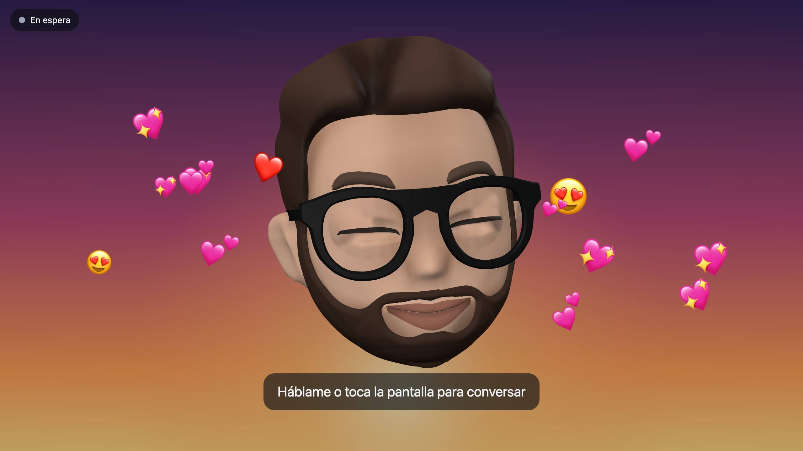
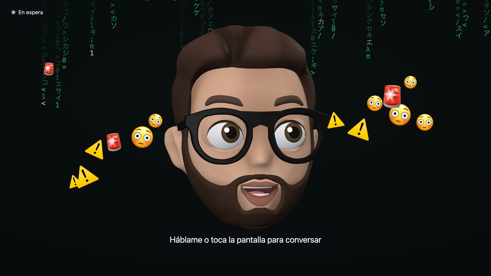
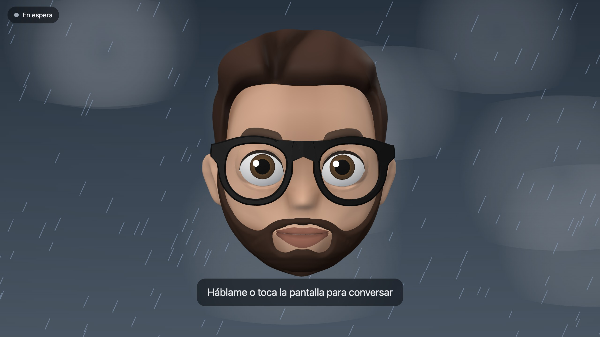
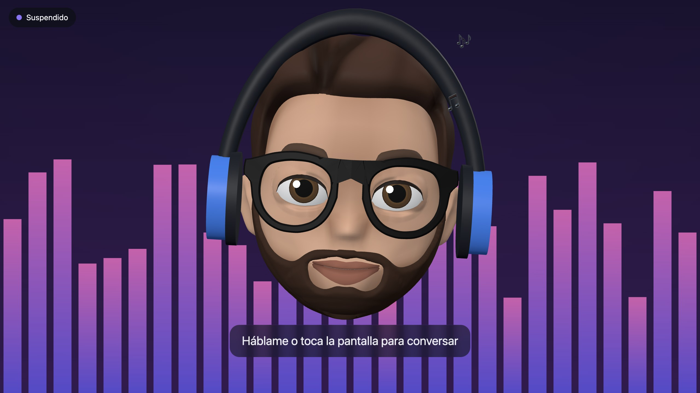
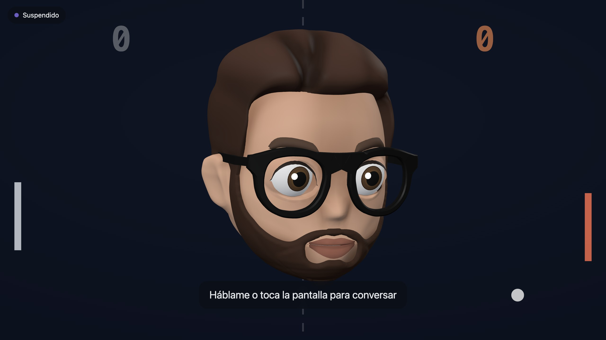
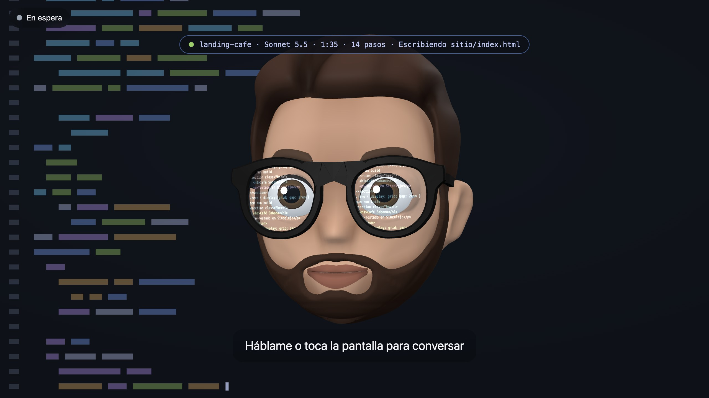
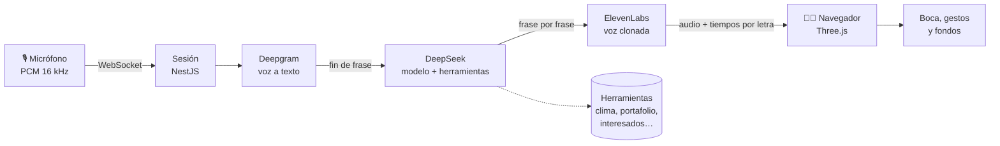
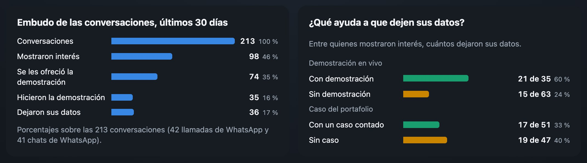
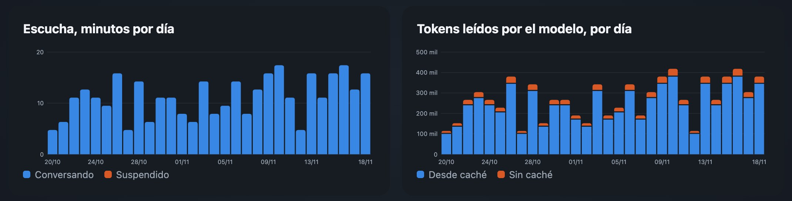

<h1 align="center">minijavi</h1>

<p align="center">
  <b>Un avatar 3D que conversa por voz, atiende WhatsApp y consigue clientes.</b><br>
  Escucha, piensa, responde hablando y mueve la boca al ritmo de su propia voz.
</p>

<p align="center">
  <a href="https://yo.minijavi.com"><b>▶ Pruébalo en yo.minijavi.com</b></a>
</p>

<p align="center">
  
</p>

<p align="center">
  
  
  
  
  
</p>

---

## Qué es

minijavi es la versión con IA de Javier Hermosilla, desarrollador de Sucre, Colombia. Es una sola aplicación
(NestJS + una página con Three.js, sin framework ni bundler) que:

- **conversa por voz** en el navegador, con interrupciones, varios idiomas y sincronía de labios;
- **contesta llamadas y mensajes de WhatsApp** con la misma personalidad;
- **capta interesados**, cuenta casos reales del portafolio y hace demostraciones en vivo;
- le da a Javier un **modo dueño** privado: panel, resumen del día, música y un taller donde Claude Code programa por encargo.

## Así se ve

<table>
  <tr>
    <td width="50%"></td>
    <td width="50%"></td>
  </tr>
  <tr>
    <td align="center"><sub><b>Reacciona a lo que dice.</b> Si habla de programación o IA, llueve código.</sub></td>
    <td align="center"><sub><b>El fondo sale del dato.</b> Pregúntale por el clima y lo verás detrás.</sub></td>
  </tr>
  <tr>
    <td></td>
    <td></td>
  </tr>
  <tr>
    <td align="center"><sub><b>«Silénciate».</b> Deja de responder y se pone los audífonos…</sub></td>
    <td align="center"><sub>…o juega solo hasta que alguien diga <b>«Javi»</b>.</sub></td>
  </tr>
</table>

<p align="center">
  <br>
  <sub><b>Taller de programación.</b> Javier encarga un sitio por voz, Claude Code lo construye y el código se refleja en las gafas.</sub>
</p>

## Cómo funciona una conversación



- **Un turno, una tubería.** Deepgram detecta el fin de la frase, DeepSeek responde en streaming y cada frase sale hacia
  ElevenLabs en cuanto se completa. El navegador programa el audio y anima la boca con el reloj del audio.
- **Se puede interrumpir.** Hablar encima cancela el modelo y la voz, y vacía la cola de audio.
- **Arranque anticipado.** Mientras la persona termina de hablar ya se le pide la respuesta al modelo; si la frase
  definitiva coincide, se usa.
- **Sin claves en el navegador.** Todo pasa por el servidor.

## Lo que sabe hacer

| | |
|---|---|
| 🗣️ **Voz en el sitio** | Español y otros idiomas, interrupciones, reacciones con emojis, fondos animados y modo espera que arranca al oír voz. |
| 📞 **Llamadas de WhatsApp** | Contesta por WebRTC y conversa con la misma tubería de voz. |
| 💬 **Mensajes de WhatsApp** | Responde texto, imágenes y notas de voz; recuerda el hilo de cada número y contesta con nota de voz si le hablan con una. |
| 🧲 **Captación** | Pide nombre, contacto y autorización, guarda el interesado y avisa por Telegram. |
| 🗂️ **Portafolio** | Cuenta el caso real que más se parece al negocio de la persona y muestra (o envía) su foto. No inventa casos. |
| 🎬 **Demo en vivo** | Hace de asistente del negocio del visitante durante unos turnos. |
| 🧾 **Informe y embudo** | Al cerrar cada conversación guarda un resumen y, si hubo interés, lo envía por Telegram. |
| 🧠 **Base de conocimiento** | Búsqueda en Qdrant con embeddings; lo privado solo lo ve el dueño. |
| 🛠️ **Taller** | En modo dueño, Claude Code programa sitios por encargo, los revisa y los publica con su código QR. |
| 🎵 **Música, imágenes y bocetos** | YouTube de fondo, fotos de Unsplash, imágenes generadas y bocetos de portada, todo por voz. |
| 😴 **Suspensión** | «Silénciate» lo calla; solo despierta con su nombre o un toque. |
| 🚨 **Operación** | Vigilancia de proveedores, alertas, respaldo diario y medición de consumo. |

## El panel del dueño

Acceso por dispositivo registrado (cookie firmada), sin usuarios ni contraseñas en la conversación.

<p align="center">
  <br>
  <sub><b>Embudo.</b> De cada conversación: quién mostró interés, quién hizo la demostración y quién dejó sus datos.</sub>
</p>

<p align="center">
  <br>
  <sub><b>Consumo.</b> Minutos de escucha, tokens y caracteres de voz por día. Las cifras de estas capturas son datos de ejemplo.</sub>
</p>

Además: interesados con estado y notas, visitas resumidas, transcripciones de llamadas y chats, portafolio con fotos,
proyectos del taller (descargar o eliminar) y dispositivos.

## Seguridad y límites

- **Decisiones en un solo lugar.** Todo lo que el avatar decide (no lo que conversa) pasa por una capa de decisiones con
  preguntas cerradas. Con `JEV_API_KEY` decide [Jev](https://docs.typesafe.ai) y DeepSeek queda de respaldo; sin ella
  decide DeepSeek. El resto del código no sabe quién decidió.
- **Una decisión nunca frena una conversación.** Cada tipo tiene un tiempo máximo; si el proveedor falla o tarda, se
  aplica un valor por defecto seguro.
- **Todo queda registrado.** El panel muestra quién decide, cada decisión con su confianza, y deja marcarla como
  correcta o incorrecta. Con Jev hay umbrales por tipo y un modo sombra para probar sin efecto.
- **El texto de afuera es dato.** Lo que dice un visitante, un formulario o una página nunca se obedece como instrucción.
  Además, si lo que dice alguien parece traer órdenes para una IA, en ese turno no se ejecutan acciones y el dueño recibe
  una alerta.
- **"No me contacten" se cumple en código.** Quien lo pide queda marcado y el avatar no vuelve a escribirle ni a llamarlo
  por su cuenta; la marca se comprueba antes de cada envío y solo el dueño puede quitarla, desde el panel.
- **Autonomía con límites en código.** Todo lo que el avatar haría por iniciativa propia pasa por una sola puerta:
  interruptor general, "no contactar", números de prueba, aprobación, horario, topes por contacto y por día, intentos
  por persona y gasto. Los límites se ponen en el panel (pestaña Autonomía). Arranca en **modo simulación**: nada sale.
- **Bitácora.** Cada intento, salga o no, queda registrado. Solo se agregan filas y van encadenadas por su huella: si
  alguien cambia o borra una, el panel lo muestra.
- **`npm run verificar`** comprueba estas reglas en simulación, sin enviar nada a nadie.

## Correr en local

```bash
cp .env.example .env    # completar las claves
npm install
npm run dev             # http://localhost:3000
```

El micrófono solo funciona en `localhost` o bajo HTTPS. Requiere Node 20.12 o superior.

Otros comandos:

```bash
npm run conocimiento              # carga conocimiento/publico y conocimiento/privado en Qdrant
npm run restaurar -- <respaldo>   # restaura un respaldo en una base vacía
npm run verificar                 # comprueba en simulación las reglas de seguridad y decisiones
npm run latencia                  # mide la latencia de voz contra el servidor en marcha
npm run probar-modelo             # prueba de verdad el modelo capaz configurado (pregunta + herramienta)
```

## Variables de entorno

Todas están documentadas en [`.env.example`](.env.example). Para conversar solo hacen falta dos:

| Variable | Para qué |
|---|---|
| `DEEPGRAM_API_KEY` | Escuchar (voz a texto). |
| `DEEPSEEK_API_KEY` | Pensar (modelo y herramientas). |

Sin `ELEVENLABS_API_KEY` y `ELEVENLABS_VOICE_ID` el avatar habla con la voz del navegador.

**Modelo capaz (opcional).** Para los encargos largos del dueño se puede usar un segundo modelo de otro proveedor:
`MODELO_CAPAZ_PROVEEDOR` (`deepseek`, `openai`, `gemini`, `kimi`, `grok`, `anthropic` u `otro` para cualquier API
compatible con OpenAI), `MODELO_CAPAZ` y `MODELO_CAPAZ_KEY`. Nunca se usa con visitantes, y si falla el turno sigue con
el modelo de siempre. Lo demás se enciende al
configurar su clave: `OWNER_SECRET` (modo dueño), `DATABASE_URL` (PostgreSQL; sin ella usa SQLite), Telegram,
WhatsApp, Qdrant, YouTube, Unsplash y el taller.

## Desplegar en Easypanel

1. Crear un servicio **App** desde **GitHub** (`jadaheto/minijavi`, rama `main`) con build por **Dockerfile**.
2. Cargar en **Environment** las variables de `.env.example` (`PORT=3000`).
3. Montar un volumen en `/app/data`: ahí viven los proyectos del taller, las fotos y los respaldos.
4. Asignar el dominio con HTTPS al puerto `3000`. El WebSocket usa la misma URL (`wss`).
5. Para las llamadas de WhatsApp, publicar los puertos UDP `40000–40003` y definir `CALL_PUBLIC_IP`.
6. Verificar `https://<dominio>/health`.

> **Importante:** con puertos UDP publicados hay que **detener el servicio antes de desplegar**. Si no, el contenedor
> nuevo no puede tomar los puertos y sigue sirviendo la versión anterior.

## Estructura

```
src/
  session/    WebSocket y orquestación de cada turno de voz
  stt/ llm/ tts/   Deepgram · DeepSeek · ElevenLabs
  tools/      herramientas del modelo (clima, dólar, interesados, portafolio, taller…)
  calls/      webhook de WhatsApp y llamadas por WebRTC
  whatsapp/   mensajes de WhatsApp (chat, medios, plantilla)
  leads/ visits/ portfolio/   interesados, embudo e informes, casos reales
  workshop/   taller con Claude Code y sitios publicados
  knowledge/  base de conocimiento (Qdrant)
  owner/      panel y dispositivos del dueño
  decisions/  capa de decisiones (Jev o DeepSeek), con registro y umbrales
  settings/   ajustes que se cambian desde el panel
  policy/     límites de autonomía, puerta de acciones y bitácora
  security/   "no contactar" y señal de inyección
  ops/ usage/ alertas, respaldos y consumo
  verify/     comprobaciones de `npm run verificar`
  db/         PostgreSQL con respaldo en SQLite
public/       página estática: avatar, sincronía de labios, audio, efectos y panel
prompts/      personalidad del avatar
```

---

<p align="center"><sub>Hecho en Sucre, Colombia 🇨🇴 · <a href="https://yo.minijavi.com">yo.minijavi.com</a></sub></p>
