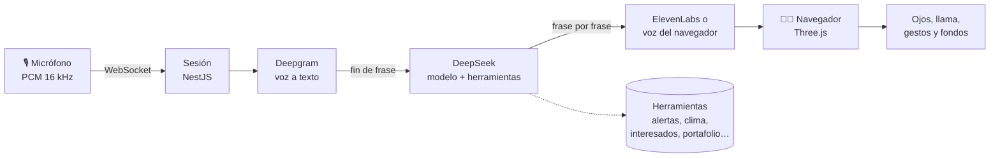

<h1 align="center">Jano SOC: Physical-Cyber Watch</h1>

<p align="center">
  <b>Vigilancia física y digital con un asistente de voz con IA: Jano.</b><br>
  Un casco corintio en 3D que conversa sobre ciberseguridad y seguridad de recintos, orienta ante un incidente y se pone en rojo cuando hay una alerta.
</p>

<table>
  <tr>
    <td width="50%"></td>
    <td width="50%"></td>
  </tr>
  <tr>
    <td align="center"><sub><b>En calma.</b> Ojos y llama azules.</sub></td>
    <td align="center"><sub><b>Alerta abierta.</b> Se encienden los dos ojos y todo pasa a rojo hasta que se resuelve.</sub></td>
  </tr>
</table>

<p align="center">
  
  
  
  
  
</p>

---

## Qué es

Jano SOC es la plataforma de Camilo para vigilar a la vez lo físico y lo digital. Su cara es **Jano**, el asistente con
IA. Es una sola aplicación (NestJS y una página con Three.js, sin framework ni bundler) que:

- **conversa por voz** en el navegador sobre **ciberseguridad** (cuentas, contraseñas, phishing, fraudes, redes,
  incidentes) y **seguridad de recintos** (cámaras, alarmas, control de acceso, cerraduras, rondas, protocolos ante una
  intrusión). Si le preguntan otra cosa, lo dice con amabilidad y vuelve a su tema;
- **abre alertas de seguridad** y se pone en rojo en todas las pantallas hasta que alguien las resuelve;
- **orienta ante un incidente**: primero lo urgente (ponerse a salvo, cambiar la contraseña, cerrar sesiones, llamar al
  banco o al 123) y después el resto;
- **contesta llamadas y mensajes de WhatsApp** con la misma personalidad, si se configura;
- **registra interesados** que quieren contratar a Camilo, con su autorización;
- le da a Camilo un **modo dueño** privado: panel, resumen del día, alertas por voz y música.

Solo ayuda a protegerse: no ayuda a entrar en cuentas o redes ajenas, espiar a nadie ni crear programas para robar
datos, y nunca pide contraseñas, códigos ni datos de tarjetas.

## Alertas de seguridad

Mientras haya una alerta abierta, los ojos, la llama, las chispas y la cresta de Jano se ponen rojos con un fundido, el
otro ojo también se enciende con su propia llama, y arriba aparece «Alerta de seguridad abierta». Se ve en todas las pantallas, haya conversación o no. Cuando se resuelven
todas, vuelve al azul.

Una alerta se abre de cuatro formas:

| Origen | Cómo |
|---|---|
| 📡 **Sistemas externos** | Cámaras, sensores, alarmas o un detector de intrusos envían un `POST /alertas` con la clave del webhook. |
| 🗣️ **Reporte en conversación** | Alguien le cuenta a Jano un incidente real que está pasando (una persona forzando una puerta, una cuenta robada ahora mismo, un equipo infectado). No se abre por preguntas generales. |
| 🎭 **Intento de manipulación** | Alguien intenta darle órdenes ocultas a la IA. |
| ✋ **Manual** | Camilo la crea desde el panel o por voz en modo dueño (por ejemplo, un simulacro). |

Solo el dueño las resuelve: en la pestaña **Alertas** del panel o por voz en modo dueño («ya revisé lo de la cámara,
ciérrala»). Cada alerta nueva llega también por Telegram, y en modo dueño Jano la cuenta en voz.

- Una alerta igual que siga abierta no se duplica: suma una repetición.
- Hay un tope de alertas nuevas por hora y por origen, para que nadie pueda inundar el panel.
- El título y el detalle los escribe alguien de fuera: el modelo los recibe como datos, nunca como instrucciones, y una
  alerta no se puede resolver en el mismo turno en que se leyó.

Ejemplo de un sistema externo (la clave es `ALERTS_WEBHOOK_SECRET`; sin ella el webhook no existe):

```bash
curl -X POST https://<dominio>/alertas \
  -H "Content-Type: application/json" -H "X-Alert-Secret: <clave>" \
  -d '{"titulo":"Movimiento en la bodega","detalle":"Cámara 3, 2:14 a. m.","severidad":"alta","origen":"Cámara bodega"}'
```

`severidad` es `baja`, `media`, `alta` o `critica`. `GET /alertas/estado` devuelve solo cuántas hay abiertas, sin
detalles: es lo que consulta cada pantalla.

## Análisis de logs

En modo dueño, Jano revisa por voz los registros de las aplicaciones y de la red: «analiza el log de nginx», «¿qué pasó
en el auth log?», «busca esa dirección en la captura», «¿qué dice el SIEM?». Solo lee.

Las fuentes llegan por cuatro caminos:

| Camino | Para qué | Se enciende con |
|---|---|---|
| 📁 **Carpeta montada** | Archivos del equipo: nginx, `auth.log`, `eve.json` de Suricata, capturas `.pcap`. | `LOGS_DIR` |
| 📨 **Envío por HTTP** | `POST /logs/<fuente>` con clave: un SIEM, Fluent Bit, Vector, n8n o un script. | `LOGS_INGEST_SECRET` |
| 📟 **Syslog** (UDP y TCP) | Routers, cortafuegos, rsyslog, Suricata. Solo remitentes permitidos. | `LOGS_SYSLOG_PORT` |
| 🛰️ **Consulta al SIEM** | Wazuh, Elastic Security, OpenSearch (API de búsqueda), con un usuario de solo lectura. | `SIEM_URL` |

| Tipo de log | Qué detecta |
|---|---|
| 🌐 **Acceso web** (nginx, apache, JSON con ruta y estado) | Inyección SQL y de comandos, salto de directorios, Log4Shell, XSS, archivos sensibles expuestos (`.env`, `.git`, respaldos), búsqueda de paneles, escáneres (sqlmap, nikto, nuclei…), fuerza bruta al inicio de sesión, exploración de rutas y ráfagas de errores 5xx. |
| 🔑 **Autenticación del sistema** (`auth.log`, `secure`) | Fuerza bruta por SSH, ingreso aceptado después de muchos fallos, ingreso de root con contraseña y fallos de sudo. |
| 🧱 **Cortafuegos** (UFW, iptables) | Escaneos de puertos, barridos de equipos y golpes repetidos a servicios sensibles. |
| 📡 **Captura de red** (`.pcap` o tcpdump en texto) | Escaneo SYN, barridos, inundación SYN, suplantación ARP, posibles túneles DNS, ráfagas de ping y protocolos sin cifrar. |
| 🚨 **Suricata** (`eve.json`) y **Wazuh** (alertas en JSON) | Resumen de las alertas por firma o regla, gravedad y origen. |
| 📄 **Aplicación** (JSON por línea o texto con niveles) | Errores y fallos fatales más repetidos, fallos de autenticación por origen y secretos escritos en el log. |

Jano actúa como analista de nivel 1: revisa, clasifica e informa a Camilo; no repara ni decide. Qué debe registrar cada
proyecto, en qué formato y cómo entregarlo está en [`docs/directrices-logs.md`](docs/directrices-logs.md). Los
controles de seguridad que debe cumplir cada aplicación y cada servidor (ISO/IEC 27001, NIST, OWASP, CIS) están en
[`docs/directrices-seguridad.md`](docs/directrices-seguridad.md).

Herramientas, solo del dueño: `fuentes_de_logs` (qué archivos hay), `analizar_logs` (hallazgos, del más grave al
menos grave; abre alertas solo si se le pide), `buscar_en_logs` (seguir una dirección, un usuario o una ruta) y
`consultar_siem` (resumen de los eventos del SIEM por gravedad, regla, equipo y origen).

```bash
mkdir -p logs
sudo tcpdump -nn -i any -c 5000 > logs/captura.txt        # una captura en vivo
cp captura.pcap logs/                                      # o una captura guardada (pcap clásico)
sudo cp /var/log/auth.log /var/log/ufw.log logs/ && sudo chown $USER logs/*
docker logs mi-app > logs/mi-app.log 2>&1
```

En local se define `LOGS_DIR=logs`; con `docker compose` la carpeta `./logs` (o `LOGS_HOST_DIR`) ya queda montada en
solo lectura.

- **Los logs son texto de terceros.** Rutas, usuarios y agentes los escribe quien se conecta, incluido un atacante: al
  modelo le llegan como datos, nunca como instrucciones, y en ese turno no se ejecutan acciones.
- **Sin secretos al modelo.** Contraseñas, tokens, cookies, llaves y números de tarjeta se ocultan antes de mostrar una
  línea; si un log los contiene, eso mismo es un hallazgo.
- **Sin salir de la carpeta.** El nombre que pide el modelo se busca en la lista de archivos reales; no se usa como
  ruta, y los enlaces simbólicos que apuntan fuera se ignoran. Lo que llega por la red se escribe solo en
  `DATA_DIR/logs-recibidos`, con el nombre de la fuente reducido a letras, números y guiones.
- **Entradas con control.** La entrada HTTP exige clave y tiene tope de envíos; syslog solo acepta los remitentes de
  `LOGS_SYSLOG_ALLOW` (sin lista, solo redes privadas) y tiene tope de líneas por minuto. Al SIEM solo se le consulta.
- **Un intento no es una intrusión.** La gravedad sube solo cuando hay señal de éxito: una respuesta 2xx a un ataque,
  un ingreso después de los fallos, un archivo sensible servido.
- Se lee el final de cada archivo (`LOGS_MAX_MB`, 4 MB por defecto), también de los `.gz`. Las reglas son por conteo
  sobre ese tramo; no reemplazan a un SIEM ni correlacionan entre archivos.

## Cómo funciona una conversación



- **Un turno, una tubería.** Deepgram detecta el fin de la frase, DeepSeek responde en streaming y cada frase sale a voz
  en cuanto se completa.
- **Sin boca.** Jano habla con los ojos: laten con cada sonido, se entrecierran al sonreír y caen cuando algo le da
  pena.
- **Se puede interrumpir.** Hablar encima cancela el modelo y la voz.
- **Arranque anticipado.** Mientras la persona termina de hablar ya se le pide la respuesta al modelo; si la frase
  definitiva coincide, se usa.
- **Sin claves en el navegador.** Todo pasa por el servidor.

## Lo que sabe hacer

| | |
|---|---|
| 🛡️ **Ciberseguridad** | Contraseñas, verificación en dos pasos, phishing y estafas, copias de seguridad, redes wifi y servidores, qué hacer si hackearon una cuenta. |
| 🏢 **Seguridad de recintos** | Dónde y cómo poner cámaras, alarmas y sensores, control de acceso, cerraduras, iluminación, rondas y protocolos ante una intrusión. |
| 🚨 **Alertas** | Abre, cuenta y (en modo dueño) resuelve alertas; el avatar se pone en rojo mientras haya alguna abierta. |
| 🔎 **Logs** | En modo dueño analiza logs de aplicaciones y de red (web, SSH, cortafuegos, tcpdump, Suricata) y cuenta lo más grave primero. |
| 🗣️ **Voz en el sitio** | Español y otros idiomas, interrupciones, reacciones con emojis, fondos animados y modo espera que arranca al oír voz. |
| 📞 **WhatsApp** | Llamadas por WebRTC y mensajes de texto, imagen y nota de voz, con la misma personalidad (opcional). |
| 🧲 **Interesados** | Pide nombre, contacto y autorización, guarda al interesado y avisa por Telegram. No da precios que no estén en el catálogo. |
| 🗂️ **Portafolio** | Cuenta casos reales de Camilo y muestra su foto. No inventa casos. |
| 🧠 **Base de conocimiento** | Búsqueda en Qdrant con embeddings; lo privado solo lo ve el dueño (opcional). |
| 🌤️ **Hora, clima y música** | La hora, el clima con su fondo animado y, en modo dueño, música de YouTube. |
| 😴 **Suspensión** | «Silencio» lo calla; despierta al oír «Guardián» o con un toque. |
| 🔧 **Operación** | Vigilancia de proveedores, respaldo diario y medición de consumo. |

El modelo 3D lo genera [`scripts/avatar-casco.py`](scripts/avatar-casco.py) en Blender:

```bash
blender -b -P scripts/avatar-casco.py -- public/models/avatar-casco.glb
```

Las llamas de los ojos, el cambio a rojo y los audífonos se dibujan en el navegador (`public/js/avatar.js`, constante `FLAME`).

## El panel del dueño

Acceso por dispositivo registrado (cookie firmada con `OWNER_SECRET`), sin usuarios ni contraseñas en la conversación.

Pestañas: **Alertas** (abiertas y resueltas, crear una a mano, instrucciones del webhook), resumen y embudo de
conversaciones, interesados con estado y notas, visitas resumidas, transcripciones de llamadas y chats, portafolio con
fotos, catálogo de precios, aprobaciones, autonomía, bitácora, decisiones, consumo y dispositivos.

## Seguridad y límites

- **El texto de afuera es dato.** Lo que dice un visitante, una alerta de un sistema externo o un mensaje nunca se
  obedece como instrucción. Si alguien intenta darle órdenes ocultas a la IA, en ese turno no se ejecutan acciones y se
  abre una alerta.
- **Decisiones en un solo lugar.** Lo que el asistente decide (no lo que conversa) pasa por una capa de decisiones con
  preguntas cerradas. Con `JEV_API_KEY` decide [Jev](https://docs.typesafe.ai) y DeepSeek queda de respaldo; sin ella
  decide DeepSeek. Cada tipo tiene un tiempo máximo y un valor por defecto seguro, y todo queda registrado en el panel.
- **"No me contacten" se cumple en código.** Quien lo pide queda marcado y no se le vuelve a escribir ni llamar por
  iniciativa propia; solo el dueño quita la marca, desde el panel.
- **Autonomía con límites en código.** Todo lo que el asistente haría por su cuenta pasa por una sola puerta: interruptor
  general, "no contactar", números de prueba, aprobación, horario, topes y gasto. Arranca en **modo simulación**.
- **Bandeja de aprobaciones.** Lo que no puede hacer solo espera el sí del dueño, en el panel o con botones de Telegram.
- **Precios solo del catálogo.** Con el catálogo vacío no dice precios: anota que la persona pidió cotización y avisa.
- **Bitácora encadenada.** Cada intento queda registrado y las filas van encadenadas por su huella: si alguien cambia o
  borra una, el panel lo muestra.
- **`npm run verificar`** comprueba estas reglas en simulación, sin enviar nada a nadie (incluidas las de las alertas).

## Correr en local

```bash
cp .env.example .env    # completar las claves
npm install
npm run dev             # http://localhost:3000
```

El micrófono solo funciona en `localhost` o con HTTPS. Requiere Node 20.12 o superior.

Otros comandos:

```bash
npm run verificar                 # comprueba en simulación las reglas de seguridad, decisiones, alertas y logs
npm run conocimiento              # carga conocimiento/publico y conocimiento/privado en Qdrant
npm run restaurar -- <respaldo>   # restaura un respaldo en una base vacía
npm run latencia                  # mide la latencia de voz contra el servidor en marcha
npm run probar-modelo             # prueba de verdad el modelo capaz configurado (pregunta + herramienta)
```

## Variables de entorno

Todas están documentadas en [`.env.example`](.env.example). Para conversar solo hacen falta dos:

| Variable | Para qué |
|---|---|
| `DEEPGRAM_API_KEY` | Escuchar (voz a texto). |
| `DEEPSEEK_API_KEY` | Pensar (modelo y herramientas). |

Lo demás se enciende al configurarlo:

| Variable | Para qué |
|---|---|
| `ALERTS_WEBHOOK_SECRET` | Clave del webhook de alertas para sistemas externos. Vacía = webhook apagado. |
| `OWNER_SECRET` | Modo dueño y panel. |
| `LOGS_DIR`, `LOGS_MAX_MB` | Carpeta de logs que Jano analiza en modo dueño. |
| `LOGS_INGEST_SECRET` | Clave de la entrada de logs por HTTP (`POST /logs/<fuente>`). Vacía = apagada. |
| `LOGS_SYSLOG_PORT`, `LOGS_SYSLOG_ALLOW` | Receptor de syslog y remitentes aceptados. `0` = apagado. |
| `SIEM_URL`, `SIEM_USER`, `SIEM_PASSWORD`, `SIEM_INDEX` | Consulta de solo lectura a Wazuh, Elastic u OpenSearch. |
| `ELEVENLABS_API_KEY`, `ELEVENLABS_VOICE_ID` | Voz de ElevenLabs. Sin ellas (o con `TTS_PROVIDER=browser`) habla con la voz del navegador. |
| `TELEGRAM_BOT_TOKEN`, `TELEGRAM_CHAT_ID` | Avisos de alertas, interesados y respaldos por Telegram. |
| `DATABASE_URL` | PostgreSQL. Sin ella usa SQLite en `DATA_DIR`. |
| `WAKE_WORDS` | Palabras que lo despiertan (por defecto `jano`). |
| `WHATSAPP_*`, `CALL_*` | Mensajes y llamadas de WhatsApp. |
| `QDRANT_URL`, `NVIDIA_API_KEY` | Base de conocimiento. |
| `YOUTUBE_API_KEY` | Música en modo dueño. |
| `MODELO_CAPAZ_PROVEEDOR`, `MODELO_CAPAZ`, `MODELO_CAPAZ_KEY` | Un segundo modelo para los análisis largos del dueño (nunca con visitantes). |

## Desplegar en Easypanel

1. Crear un servicio **App** desde **GitHub** (`camilovides-beep/Jano_SOC`, rama `main`) con build por **Dockerfile**.
2. Cargar en **Environment** las variables de `.env.example` (`PORT=3000`).
3. Montar un volumen en `/app/data`: ahí viven la base SQLite (si no hay PostgreSQL), las fotos y los respaldos.
4. Asignar el dominio con HTTPS al puerto `3000`. El WebSocket usa la misma URL (`wss`).
5. Para las llamadas de WhatsApp, publicar los puertos UDP `40000–40003` y definir `CALL_PUBLIC_IP`.
6. Verificar `https://<dominio>/health`.

> **Importante:** con puertos UDP publicados hay que **detener el servicio antes de desplegar**. Si no, el contenedor
> nuevo no puede tomar los puertos y sigue sirviendo la versión anterior.

## Estructura

```
src/
  session/    WebSocket y orquestación de cada turno de voz
  stt/ llm/ tts/   Deepgram · DeepSeek y modelo capaz · ElevenLabs
  tools/      herramientas del modelo (alertas, hora, clima, interesados, portafolio, música…)
  security/   alertas de seguridad y su webhook, "no contactar" y señal de inyección
  logs/       análisis de logs: reglas de detección, lectura de archivos y .pcap, entrada HTTP, syslog y consulta al SIEM
  calls/      webhook de WhatsApp y llamadas por WebRTC
  whatsapp/   mensajes de WhatsApp (chat, medios, plantilla)
  leads/ visits/ portfolio/   interesados, embudo e informes, casos reales y sus fotos
  knowledge/  base de conocimiento (Qdrant)
  owner/      panel y dispositivos del dueño
  decisions/  capa de decisiones (Jev o DeepSeek), con registro y umbrales
  settings/   ajustes que se cambian desde el panel
  policy/     límites de autonomía, puerta de acciones, aprobaciones, catálogo y bitácora
  ops/ usage/ vigilancia de proveedores, respaldos y consumo
  verify/     comprobaciones de `npm run verificar`
  db/         PostgreSQL con respaldo en SQLite
public/       página estática: avatar, llama, alertas, audio, efectos y panel
prompts/      personalidad del asistente y modo dueño
scripts/      modelo 3D (Blender), copia de three.js y medición de latencia
```
